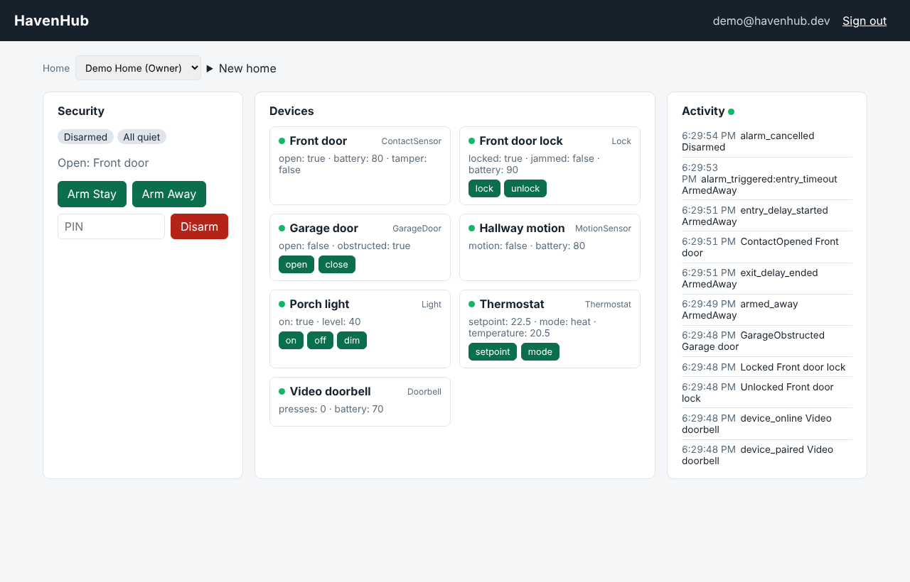

# HavenHub – smart-home security cloud service

HavenHub is the backend that lets people control their home security system and smart devices from
anywhere: locks, garage doors, thermostats, lights, door/window sensors, motion sensors and video
doorbells. It also runs each home's alarm panel (arm Stay/Away, entry and exit delays, alarm).

Built in **C# / .NET 8 (ASP.NET Core)** with a **SQL** database, an **HTML5** dashboard, a signed
WebSocket protocol for devices, and security controls mapped to **ETSI EN 303 645**, the consumer-IoT
security standard.



## Highlights

- **Device control end to end.** REST API -> signed WebSocket -> device -> acknowledgement -> API.
  Every command reaches a final status (Acked, Failed, TimedOut, Expired). Retries are idempotent.
  Comfort commands wait for offline devices; security commands fail fast ([ADR-0003](docs/adr/0003-command-delivery-policy.md)).
- **Alarm panel** as a pure state machine (`HavenHub.Core/Security/SecurityPanel.cs`), persisted
  transactionally with every device signal. PIN disarm with lockout.
- **Object-oriented device model.** One abstract `DeviceType` with a subclass per device that
  defines actions, permissions, validation, safety interlocks and how state changes become signals.
- **SQL data layer.** Versioned migrations, constraints, foreign-key cascades, keyset pagination,
  `GROUP BY`/`JOIN` reports, partial indexes checked with `EXPLAIN QUERY PLAN` in tests, and
  single-writer/multi-reader concurrency.
- **Security by design.** Per-device secrets via one-time pairing codes; HMAC-signed messages both
  ways with replay protection; AES-256-GCM secrets at rest; PBKDF2 passwords; role-based access with
  404s for outsiders; rate limits; CSP and secure headers; a hash-chained audit log; data deletion.
  See the [ETSI EN 303 645 mapping](docs/security/etsi-en-303-645.md) and [threat model](docs/security/threat-model.md).
- **Static analysis that fails the build.** Nullable analysis plus the .NET quality, security and
  reliability analyzers with warnings as errors, and CodeQL in CI ([details and findings fixed](docs/security/static-analysis.md)).
- **Zero third-party packages** ([ADR-0001](docs/adr/0001-no-third-party-packages.md)). SQLite is
  bound through P/Invoke and CI fails if a NuGet package is added.

## Results

| | |
|---|---|
| Tests | **72** unit, data and in-process integration tests; **25/25** requirements traced to tests ([requirements](docs/requirements.md)) |
| Static analysis | 0 warnings with analyzers set to Recommended, plus all Security and Reliability rules, as errors |
| Load test | 50 homes, **350 devices** on signed WebSockets; **1,496 commands/s** with 32 concurrent clients; all **44,890 acknowledged**; round trip p50 **22 ms**, p95 **34 ms**, p99 **47 ms**; 0 messages failed verification |

The load test ran on a 2-vCPU Linux VM with the server and simulator on the same machine; every command
went API -> device -> ack -> API. Reproduce it with `scripts/run-demo.sh load --homes 50 --seconds 30 --workers 32`.
Rate limits are raised for that run only, because it creates 50 accounts from one IP.

## Run it

Requirements: .NET 8 SDK and the system SQLite library (`libsqlite3-0` on Debian/Ubuntu; built into macOS).

```bash
# Scripted demo: one home, seven simulated devices, commands, a break-in and a disarm
scripts/run-demo.sh demo

# Tests (+ traceability matrix)
dotnet run --project tests/HavenHub.Tests -- --matrix

# Run the service and open the dashboard at http://localhost:5080
ASPNETCORE_ENVIRONMENT=Development ASPNETCORE_URLS=http://localhost:5080 dotnet run --project src/HavenHub.Api
# ...then in another terminal, add devices that stay online for 10 minutes:
dotnet run --project tools/HavenHub.DeviceSim -- demo --email you@example.com --password your-long-password --hold 600
```

Outside Development the service needs `HavenHub__MasterKey` and `HavenHub__TokenKey` (base64
256-bit keys) and must run behind TLS. See [SECURITY.md](SECURITY.md).

## API (summary)

| Method | Path | Who |
|---|---|---|
| POST | `/api/auth/register`, `/api/auth/login` | anyone (rate-limited) |
| GET/DELETE | `/api/me`, POST `/api/me/logout-all` | signed in |
| GET/POST | `/api/homes`; GET/DELETE `/api/homes/{id}` | member / owner |
| POST/DELETE | `/api/homes/{id}/members[/{userId}]` | owner |
| POST | `/api/homes/{id}/pairing-codes` | owner |
| GET/DELETE | `/api/homes/{id}/devices[/{deviceId}]` | member / owner |
| POST | `/api/homes/{id}/devices/{deviceId}/commands?wait=true` | per action (guests: lights, thermostat, lock) |
| GET | `/api/homes/{id}/security`; POST `.../security/arm`, `.../security/disarm` | member |
| GET | `/api/homes/{id}/events?beforeAt=&beforeId=&limit=` | member |
| GET | `/api/homes/{id}/stream` (Server-Sent Events) | member |
| GET | `/api/homes/{id}/reports?days=7`, `/api/homes/{id}/audit` | member / owner |
| POST | `/device/pair`; WebSocket `/device/ws` | devices |

## Repository layout

```
src/HavenHub.Core        domain: device types, alarm panel, crypto, device protocol
src/HavenHub.Data        SQLite binding, migrations, repositories (all SQL)
src/HavenHub.Api         ASP.NET Core API, device gateway, services, HTML5 dashboard (wwwroot)
tools/HavenHub.DeviceSim simulated devices, API client, demo and load generator
tests/HavenHub.Tests     unit, data and integration tests + traceability runner
docs/                    design, requirements, backlog, ADRs, security
```

## Engineering process

- Requirements with ids ([docs/requirements.md](docs/requirements.md)); each test is tagged with the
  requirements it checks, and the runner fails if any requirement has no test.
- User stories, acceptance criteria and a Definition of Done ([docs/backlog.md](docs/backlog.md)),
  including the defects found during development and how each was fixed.
- Architecture decision records ([docs/adr](docs/adr)), a design document ([docs/design.md](docs/design.md)), and a PR template with a security checklist.
- CI on every push: analyzer-clean build, all tests, a dependency check, the end-to-end demo and a
  smoke load test. CodeQL runs on every push to main, every PR and weekly.

## License

MIT
